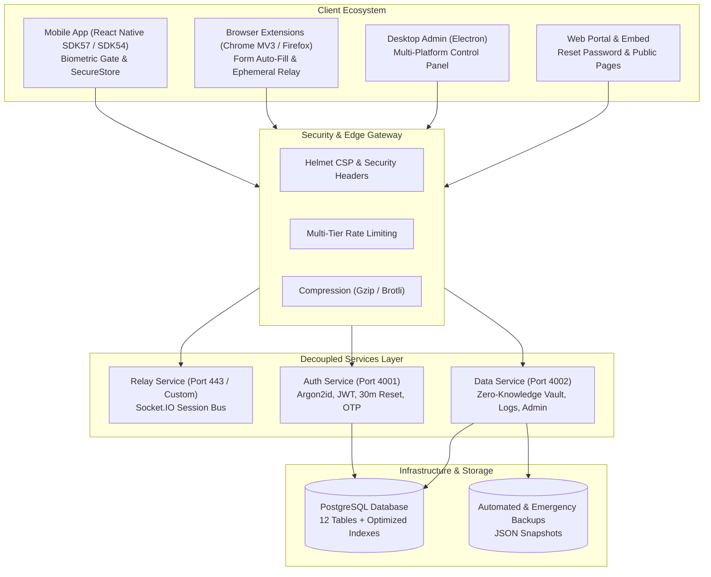
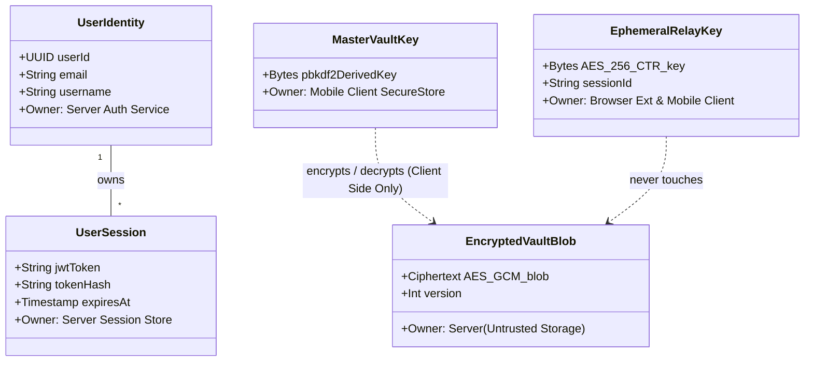
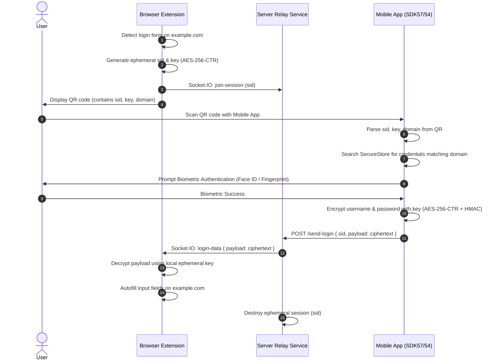
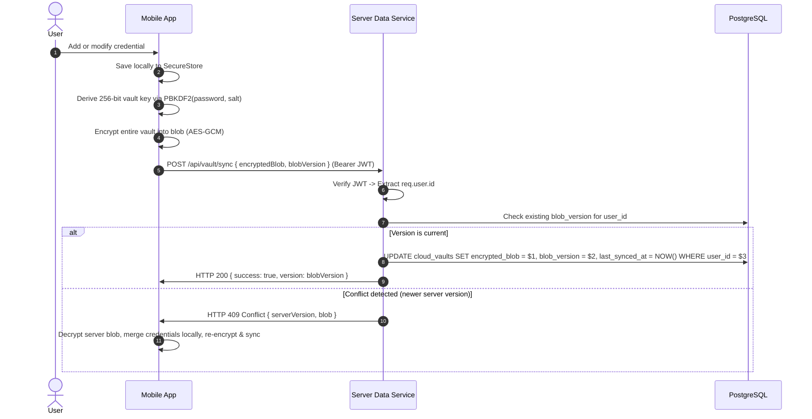
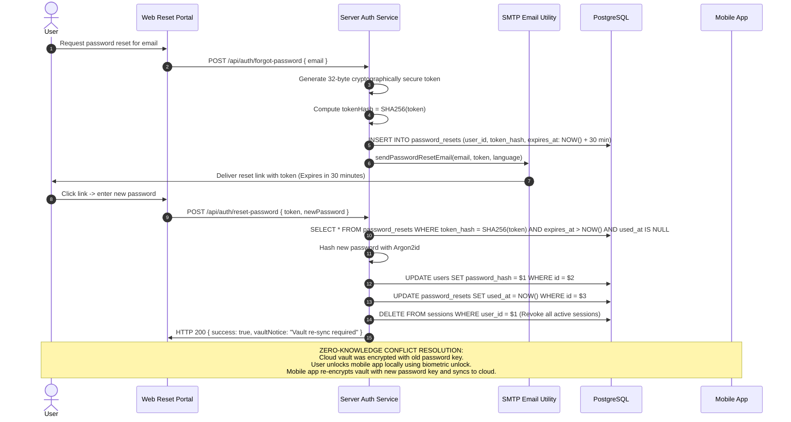

 FlakeSecure — System Architecture & Security Blueprint
**Version:** 2.0.0-Enterprise  
**Classification:** Core System Specification  
**Status:** Active / Production-Hardened  

---

 1. Architectural Philosophy & Zero-Knowledge Model

FlakeSecure is an enterprise-grade, privacy-first credential management and authentication relay ecosystem. The fundamental paradigm governing FlakeSecure is **Zero-Knowledge Confidentiality** paired with **Defense-in-Depth Isolation**:

1. **Zero-Knowledge Vault Confidentiality**: The server operates as an untrusted ciphertext storage and message relay broker. All cryptographic keys for vault decryption and credential transmission are derived exclusively on client devices (using PBKDF2-HMAC-SHA256, Argon2id, and ephemeral AES-256-CTR / AES-GCM keys). The server never possesses, computes, or logs master passwords or vault encryption keys.
2. **Strict Tenant Isolation**: All multi-tenant data structures are strictly segregated by cryptographic User UUIDs (`UUIDv4`). Cross-tenant access is structurally impossible at both database query and routing layers.
3. **Decoupled Service Resilience**: The platform can execute as a monolithic HTTPS orchestration or be cleanly separated into three independent microservices: **Relay Service**, **Auth Service**, and **Data Service**.



---

 2. What Exists? (Component Inventory)

 2.1 Clients

| Client Component | Technology | Primary Responsibilities | Key Security Properties |
| :--- | :--- | :--- | :--- |
| **Mobile App (SDK57 & SDK54)** | React Native, Expo, Hermes | Primary biometric credential repository, QR camera scanner/generator, TOTP authenticator, cloud vault sync. | OS Keychain / Keystore via `expo-secure-store`, biometric prompt before credential reveal, clipboard 45s auto-clear, spring tap feedback, pulse skeleton loading (zero spinners). |
| **Browser Extension (Chrome MV3)** | JavaScript, Manifest V3, WebCrypto | Web page form field detection, QR session pairing, real-time autofill injection. | Ephemeral in-memory key generation (`crypto.getRandomValues`), no plaintext persistence of passwords. |
| **Browser Extension (Firefox MV2/3)** | JavaScript, WebExtension API | Cross-browser compatibility for Firefox with background script relay proxying. | Isolated background bridge preventing DOM script tampering. |
| **Desktop Admin** | Electron, Node.js | Cross-platform administrative terminal (Windows exe, Linux AppImage). | Sandboxed renderer, isolated context bridge, remote management authenticated via admin tokens. |
| **Web Portal & Embed** | HTML5, CSS3, Vanilla JS | Account recovery (`/reset-password`), administrative monitoring dashboard (`/admin`), custom error pages (404, 500, 403, 429), embeddable auth widget. | Strict CSP, Stored XSS elimination with `escapeHtml()`, zero third-party tracking scripts. |

 2.2 APIs & Endpoints

| API Group | Endpoints | Authentication / Security |
| :--- | :--- | :--- |
| **Relay API** | `POST /send-login`<br/>`POST /send-totp`<br/>`GET /session-status/:sid`<br/>Socket.IO: `join-session`, `login-data`, `totp-data` | Ephemeral `sid` and `keyHex`. Rate-limited via `relayLimiter`. Ciphertext only. |
| **Auth API** | `POST /api/auth/register`<br/>`POST /api/auth/login`<br/>`POST /api/auth/logout`<br/>`GET /api/auth/me`<br/>`POST /api/auth/forgot-password`<br/>`POST /api/auth/reset-password` | Argon2id password hashing, 24h JWT with SHA-256 token hash validation against DB sessions table, 30-min cryptographically random reset tokens, `authLimiter`. |
| **OTP API** | `POST /api/otp/send`<br/>`POST /api/otp/verify` | 6-digit numeric codes, 10-minute expiry, single-use token issuance, `otpLimiter`. Mandatory for registration and account deletion. |
| **Vault API** | `GET /api/vault`<br/>`POST /api/vault/sync`<br/>`DELETE /api/vault/purge` | Zero-Knowledge encrypted blob storage (`cloud_vaults`). Version tracking for conflict resolution. Strict `WHERE user_id = $1`. |
| **Account & Security API** | `PUT /api/account/update`<br/>`DELETE /api/account/delete`<br/>`GET /api/account/restrictions`<br/>`POST /api/account/restrictions`<br/>`DELETE /api/account/restrictions/:id` | Password/OTP confirmation required for deletion. Allowed recipients whitelist enforcement. |
| **Logs & Telemetry API** | `GET /api/logs`<br/>`DELETE /api/logs/clear` | Paginated login and activity history (`limit` capped at 100), IP geolocation resolution, user-level purge. |
| **Admin API** | `POST /api/admin/login`<br/>`GET /api/admin/metrics`<br/>`GET /api/admin/logs`<br/>`GET /api/admin/backups`<br/>`POST /api/admin/backup`<br/>`GET /api/admin/backup/download/:file` | Restricted to `.env` defined `ADMIN_EMAIL` and `ADMIN_PASSWORD`. Rate-limited via `adminLoginLimiter`. Memory, CPU, DB metrics, full JSON export and download. |

 2.3 Services (Decoupled Microservice Topology)

1. **Relay Service (`services/relay/relayService.js` / `bin/relay.js`)**:
   - Manages real-time WebSockets and Socket.IO rooms.
   - Maintains in-memory session maps with 5-minute garbage collection.
   - Relays encrypted payloads between mobile devices and browser extensions without touching disk or DB.
2. **Auth Service (`services/auth/authService.js` / `bin/auth.js`)**:
   - Manages user identity, registration, login, OTP dispatch, and password resets.
   - Connects to PostgreSQL `users`, `sessions`, `otp_codes`, and `password_resets` tables.
3. **Data Service (`services/data/dataService.js` / `bin/data.js`)**:
   - Manages encrypted cloud vaults, audit logs, notification tokens, announcements, and admin operations.
   - Enforces database tenant isolation and automatic emergency backups.

 2.4 Database Schema & Indexes (PostgreSQL)

The database schema utilizes `pgcrypto` with 12 specialized tables:

```sql
-- Core Identity & Access
users (id UUID PK, email VARCHAR UNIQUE, username VARCHAR UNIQUE, password_hash, language, created_at, updated_at)
sessions (id UUID PK, user_id UUID FK, token_hash VARCHAR, device_info, ip_address INET, created_at, expires_at)
otp_codes (id UUID PK, email VARCHAR, code VARCHAR, purpose VARCHAR, attempts INT, created_at, expires_at)
password_resets (id UUID PK, user_id UUID FK, token_hash VARCHAR, expires_at, used_at, created_at)

-- Zero-Knowledge Cloud Storage
cloud_vaults (id UUID PK, user_id UUID FK UNIQUE, encrypted_blob TEXT, blob_version INT, last_synced_at)
totp_vault (id UUID PK, user_id UUID FK UNIQUE, encrypted_blob TEXT, blob_version INT, last_synced_at)

-- Sharing & Relay Persistence
allowed_recipients (id UUID PK, owner_id UUID FK, recipient_id UUID FK, created_at, UNIQUE(owner_id, recipient_id))
shared_payloads (id UUID PK, sid VARCHAR UNIQUE, payload TEXT, created_at)
received_credentials (id UUID PK, recipient_id UUID FK, sender_username, domain, encrypted_data, is_hidden, expires_at, created_at)

-- Auditing & Communications
login_logs (id UUID PK, user_id UUID FK, ip_address INET, city, region, country, isp, device_info, action, domain, created_at)
announcements (id UUID PK, title, message, priority, target_role, active, expires_at, created_at, updated_at)
push_tokens (id UUID PK, user_id UUID FK, expo_push_token VARCHAR UNIQUE, device_info, created_at, updated_at)
```

 Performance-Critical Indexes
- `idx_users_email` ON `users(email)`
- `idx_users_username` ON `users(username)`
- `idx_sessions_user_id` ON `sessions(user_id)`
- `idx_sessions_user_expires` ON `sessions(user_id, expires_at)`
- `idx_sessions_token_hash` ON `sessions(token_hash)`
- `idx_login_logs_user_created` ON `login_logs(user_id, created_at DESC)`
- `idx_shared_payloads_created` ON `shared_payloads(created_at)`
- `idx_announcements_active_expires` ON `announcements(active, expires_at)`
- `idx_otp_codes_lookup` ON `otp_codes(email, purpose, expires_at)`
- `idx_password_resets_hash` ON `password_resets(token_hash, expires_at)`

---

 3. Who Owns What? (Identity, Session & Encryption Ownership)



 3.1 Ownership Allocation Matrix

| Domain Element | Owner | Persistence Location | Access Authority |
| :--- | :--- | :--- | :--- |
| **Authentication Identity** | Server (`authService`) | PostgreSQL `users` table | Verified by Argon2id password hash or OTP code. |
| **Session Lifetime** | Server (`authService`) | PostgreSQL `sessions` table | Identified via SHA-256 hash of Bearer JWT token. Invalidated instantly upon logout or password reset. |
| **Master Vault Key** | Mobile Client (`storage.js`) | Derived on-the-fly via PBKDF2; never stored unencrypted. Password held in OS `SecureStore`. | Exclusively accessed within Mobile Client memory after user enters credentials or validates biometrics. |
| **Encrypted Cloud Vault** | Client owns plaintext; Server owns storage record | PostgreSQL `cloud_vaults` table | Stored as ciphertext. The server has **zero read capability**. |
| **Ephemeral Relay Keys** | Browser Extension & Mobile App | Ephemeral QR code query parameters (`key`, `k`) | Held in runtime memory for max 5 minutes; never written to disk or database. |
| **Audit Logs** | User owns history; Server owns storage | PostgreSQL `login_logs` table | Filtered strictly by authenticated user UUID. Auto-purged after 90 days. |

---

 4. What May Depend on What? (Boundaries & Forbidden Paths)

 4.1 Dependency Boundary Hierarchy

Architecture layers must adhere to strict uni-directional flow:
$$\text{UI Layer} \longrightarrow \text{Application Layer} \longrightarrow \text{Domain / Crypto Layer} \longrightarrow \text{Infrastructure Layer}$$

```
+-------------------------------------------------------------------+
|                           UI LAYER                                |
|  Mobile Screens, Browser Popup, Web Admin, Custom Error Pages    |
+-------------------------------------------------------------------+
                                  │
                                  ▼
+-------------------------------------------------------------------+
|                      APPLICATION LAYER                            |
|  AuthContext, LanguageContext, Express Middlewares, Route Handlers|
+-------------------------------------------------------------------+
                                  │
                                  ▼
+-------------------------------------------------------------------+
|                    DOMAIN & CRYPTO LAYER                          |
|  Vault Encryption, PBKDF2 Key Derivation, Tenant Authorization   |
+-------------------------------------------------------------------+
                                  │
                                  ▼
+-------------------------------------------------------------------+
|                    INFRASTRUCTURE LAYER                           |
|  PostgreSQL Pool, Socket.IO Relay Bus, File System Backups        |
+-------------------------------------------------------------------+
```

 4.2 Explicit List of FORBIDDEN Dependency Paths

> [!CAUTION]
> The following architectural interactions are strictly forbidden and violate the security guarantees of FlakeSecure:

1.  **FORBIDDEN: Server-Side Vault Decryption**  
   The server MUST NEVER attempt to decrypt, derive keys for, or inspect the contents of `cloud_vaults.encrypted_blob` or `totp_vault.encrypted_blob`. All vault operations on the server must treat payloads as opaque strings.
2.  **FORBIDDEN: Transmitting Plaintext Passwords to Vault Endpoints**  
   The client MUST NEVER send master passwords or derived encryption keys to `/api/vault/*`. Only the encrypted ciphertext blob and version integer may be transmitted.
3.  **FORBIDDEN: Cross-Tenant Data Access**  
   The Application Layer MUST NEVER execute queries against `cloud_vaults`, `sessions`, `login_logs`, `allowed_recipients`, `totp_vault`, or `received_credentials` without an explicit `WHERE user_id = $1` or `WHERE owner_id = $1` constraint matching the verified JWT identity.
4.  **FORBIDDEN: Browser Extension Access to Master Vault Keys**  
   The browser extension MUST NEVER request or store master vault keys. It only receives individual decrypted credentials for the active matching domain via ephemeral one-time Socket.IO sessions.
5.  **FORBIDDEN: Storing Plaintext Tokens in Database**  
   JWT tokens and password reset tokens MUST NEVER be stored in the database in plaintext. The database only stores cryptographic hashes (SHA-256 for sessions and reset tokens).
6.  **FORBIDDEN: Bypassing OTP Verification**  
   Registration (`POST /api/auth/register`) and Account Deletion (`DELETE /api/account/delete`) MUST NEVER execute without validating a cryptographic OTP token issued by the OTP verification service.
7.  **FORBIDDEN: Committing Secrets to Source Control**  
   `.env`, private SSL keys (`*.key`, `*.pem`), build artifacts (`*.apk`, `*.AppImage`), and database backup dumps (`backups/*.json`) MUST NEVER be tracked by Git.

---

 5. How Does Data Move? (Critical Data Flows)

 Flow A: Browser Autofill via Mobile Biometric Confirmation



 Flow B: Zero-Knowledge Cloud Vault Sync



 Flow C: 30-Minute Password Reset & Zero-Knowledge Conflict Handling



---

 6. What Must Stay True? (Architecture Invariants)

| Invariant | Specification | Enforcement Mechanism |
| :--- | :--- | :--- |
| **Invariant 1: Server Confidentiality** | Server never possesses secrets required to read vault contents. | PBKDF2/AES-GCM execution strictly on client devices. Zero decryption code on server. |
| **Invariant 2: Tenant Isolation** | No client can ever query or manipulate records belonging to another UUID. | `req.user.id` injected exclusively by verified JWT middleware. Parameterized SQL with `WHERE user_id = $1`. |
| **Invariant 3: Short-Lived Ephemerality** | Sensitive tokens must have minimal exposure lifetimes. | Password reset tokens expire in 30 minutes; OTP codes in 10 minutes; Relay sessions in 5 minutes; JWT tokens in 24 hours. |
| **Invariant 4: Cryptographic Hashing at Rest** | No raw tokens or passwords stored in plaintext. | Passwords hashed with Argon2id; sessions and reset tokens hashed with SHA-256 before DB insertion. |
| **Invariant 5: Disaster Recovery & Crash Snapshots** | Unhandled exceptions or server crashes must never cause silent data loss. | Process-level handlers (`uncaughtException`, `unhandledRejection`) trigger automatic emergency JSON database dumps and critical admin email alerts. |
| **Invariant 6: UI Responsiveness & Motion Feedback** | The user must never experience jarring spinners or unresponsive interactions. | Spring-based `TapFeedback` on all interactive pressables; pulsing `Skeleton` placeholders during data loading. |
| **Invariant 7: Centralized Dynamic Configuration** | Mobile screens must never hardcode server endpoints. | Dynamic resolution via `getServerUrl()` with SecureStore fallback, ensuring seamless staging/production portability. |

---

 7. 20-Point Security Audit & Hardening Matrix

| # | Security Checklist Item | Implementation Details & References | Verification Status |
| :---: | :--- | :--- | :---: |
| **1** | **Hardcoded Secrets Sanitization** | `.gitignore` hardens exclusions for `*.pem`, `*.key`, `*.apk`, `*.log`, `backups/`, `.env`. Removed all hardcoded secrets from source code. |  PASSED |
| **2** | **Stored & Reflected XSS Elimination** | `escapeHtml()` applied to all dynamic innerHTML renders in `account.html`, `admin.html`, and email templates. |  PASSED |
| **3** | **CSRF & Origin Protection** | Explicit CORS origin whitelist configured in `server.js`. Strict W3C compliant credentials handling. |  PASSED |
| **4** | **SQL Injection Prevention** | 100% parameterized queries (`pg` client with `$1, $2` parameters) across all route modules. Zero string concatenation. |  PASSED |
| **5** | **Sensitive Data Redaction in Logs** | Removed all plaintext password, auth token, and unencrypted vault logs in server routes and mobile app storage utilities. |  PASSED |
| **6** | **Password Reset Token Security** | Cryptographically secure 32-byte hex tokens, stored as SHA-256 hashes, strictly valid for 30 minutes, single-use enforcement. |  PASSED |
| **7** | **Zero-Knowledge Password Conflict** | Documented and programmatic warning: resetting account password prompts mobile client re-sync to re-encrypt vault keys. |  PASSED |
| **8** | **Multi-Tier Rate Limiting** | `express-rate-limit` configured for: Global (300/15m), Auth (15/15m), OTP (5/10m), Relay (60/15m), Admin Login (5/15m). |  PASSED |
| **9** | **Strict Tenant Segregation** | All data routes (`/vault`, `/logs`, `/account`, `/sessions`) enforce `WHERE user_id = $1` matching verified JWT identity. |  PASSED |
| **10** | **Resource & Spend Capping** | Express body parser hard-capped at 2MB payload limit. API pagination capped at max 100 records per request. |  PASSED |
| **11** | **Disaster Recovery Snapshots** | Automated JSON backup export (`/api/admin/backup`) plus emergency crash dump on uncaught server exceptions. |  PASSED |
| **12** | **Zero-Downtime Blue/Green Readiness** | Decoupled microservices architecture (`services/relay`, `services/auth`, `services/data`) capable of independent rollouts. |  PASSED |
| **13** | **Custom Error Pages** | Custom branded HTML error pages (`404.html`, `500.html`, `403.html`, `429.html`) for web; structured JSON responses for API. |  PASSED |
| **14** | **Database Index Optimization** | Indexes established on `users(email, username)`, `sessions(user_id, expires_at)`, `login_logs`, `announcements`, and `otp_codes`. |  PASSED |
| **15** | **Admin Monitoring & Telemetry** | Restricted admin portal (`/admin`) requiring `.env` credentials with live CPU/memory telemetry, audit logs, and 1-click backup downloads. |  PASSED |
| **16** | **Skeleton Loading (No Spinners)** | Created `SkeletonItem`, `CredentialCardSkeleton`, `LogRowSkeleton`, `SessionCardSkeleton`, and `DetailFieldSkeleton` with smooth pulse loop. |  PASSED |
| **17** | **Tap Motion & Feedback** | Implemented `TapFeedback` spring-scale pressable across HomeScreen, LogsScreen, SettingsScreen, ConfirmScreen, and ViewCredentialScreen. |  PASSED |
| **18** | **Dynamic Server Endpoint Resolution** | Replaced all hardcoded `SERVER_URL` constants in mobile screens with dynamic SecureStore-aware `getServerUrl()` utility. |  PASSED |
| **19** | **Performance & Asset Compression** | Integrated `compression` middleware (Gzip / Brotli) serving all static assets and JSON responses. |  PASSED |
| **20** | **Security Headers (Helmet)** | Integrated `helmet` configuring Content Security Policy (CSP), HSTS, X-Frame-Options (`SAMEORIGIN`), and MIME sniffing protection. |  PASSED |

---

 8. Disaster Recovery & Maintenance Playbook

 8.1 Automated Emergency Snapshots
In the event of an uncaught exception or fatal system rejection, `server.js` triggers an emergency recovery pipeline:
1. Generates a timestamped snapshot file: `server/backups/emergency-snapshot-<timestamp>.json`.
2. Dumps all core tables (`users`, `sessions`, `cloud_vaults`, `login_logs`, `allowed_recipients`, `totp_vault`, `announcements`).
3. Dispatches a high-priority critical alert email via `sendCriticalAlertEmail()` to `ADMIN_EMAIL`.
4. Gracefully terminates the process to allow the process supervisor (systemd / PM2 / Docker) to restart the instance.

 8.2 Database Migration Protocol
Database schema updates are managed through `server/migrate.js`. To apply or verify migrations:
```bash
node server/migrate.js
```
The migration runner checks for existing database schemas, creates missing tables, adds missing columns with defaults (`updated_at`, `password_resets`), and establishes performance indexes idempotently.

---
*FlakeSecure Enterprise Architecture Documentation — SnowyStudio*
