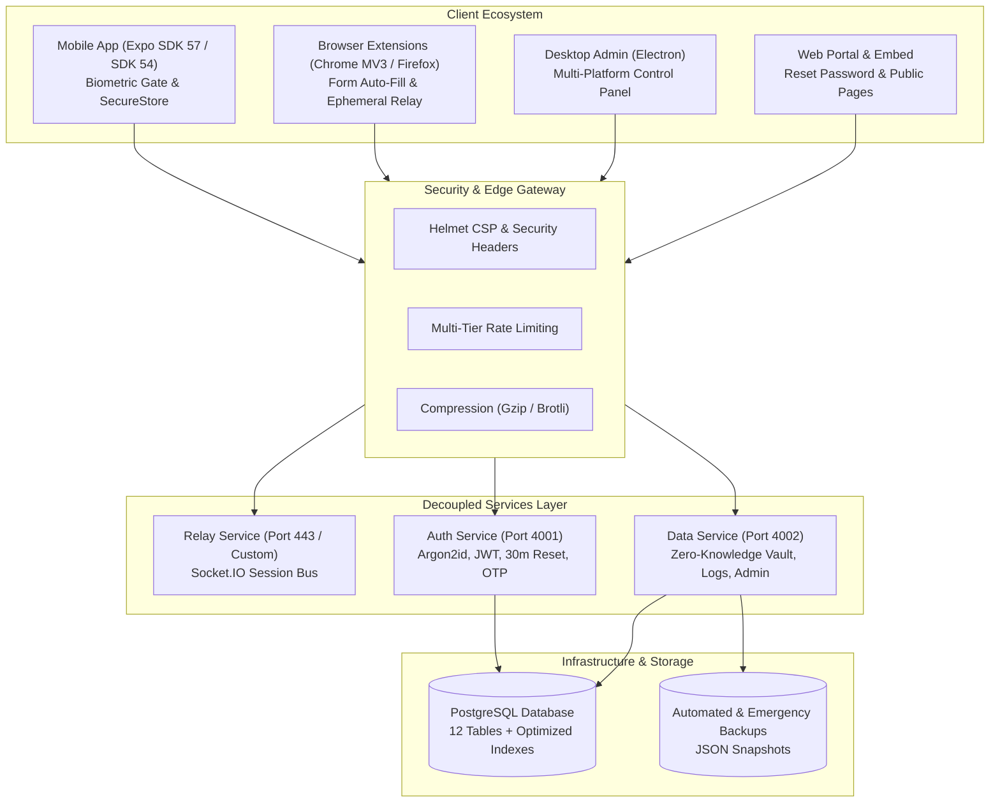

 FlakeSecure

[](package.json)
[](#-platform-support)
[](#-security-architecture--protocols)
[](ARCHITECTURE.md)
[](#)

> **Zero-Knowledge Biometric Cross-Platform Password & 2FA Manager**  
> Scan QR code on your desktop browser → Confirm via Face ID / Touch ID / Fingerprint on your smartphone → Browser logs in and auto-fills 2FA TOTP codes seamlessly via end-to-end encryption.

---

 Table of Contents

- [ What's New (Changelog)](#-whats-new-changelog)
- [ Architecture Blueprint](#-architecture-blueprint)
- [ Core Features](#-core-features)
- [ Embeddable Iframe & Drop-In SDK (For Website Providers)](#-embeddable-iframe--drop-in-sdk-for-website-providers)
- [ Project Structure](#-project-structure)
- [ Setup & Installation](#-setup--installation)
  - [1. Relay, Auth & Data Server](#1-relay-auth--data-server)
  - [2. Database Migrations](#2-database-migrations)
  - [3. Chrome / Edge / Chromium Extension](#3-chrome--edge--chromium-extension)
  - [4. Firefox Extension](#4-firefox-extension)
  - [5. Mobile App (iOS / Android)](#5-mobile-app-ios--android)
  - [6. Desktop Admin App (Windows & Linux)](#6-desktop-admin-app-windows--linux)
- [ Security Architecture & Protocols](#-security-architecture--protocols)
- [ Monitoring, Telemetry & Disaster Recovery](#-monitoring-telemetry--disaster-recovery)
- [ Scalability & Multi-Region Clustering](#-scalability--multi-region-clustering)
- [ Dependencies & Tech Stack](#-dependencies--tech-stack)
- [ License](#-license)

---

 What's New in Version 2.0.2 (Enterprise, Legal & Security Overhaul)

The **v2.0.2** update introduces an enterprise-grade architectural restructuring, complete GDPR/TDDDG compliance, active session hardware detection, multilingual legal portals, SEO optimization, and production telemetry:

 Highlights & New Features in v2.0.2:

1.  **Full Legal & Regulatory Compliance (GDPR / DSGVO, TDDDG, DDG & BGB)**:
   - **Impressum / Legal Notice (`/imprint`)**: Fully compliant with § 5 DDG & § 18 MStV, complete with dispute resolution disclosures.
   - **Privacy Policy (`/legal`)**: Comprehensive GDPR (DSGVO), BDSG & TDDDG compliant declaration explaining the Zero-Knowledge cryptographic model, tracking-free infrastructure, cookie-free operations, and user rights (Art. 15–21 GDPR).
   - **Terms of Service (`/terms`)**: BGB-compliant terms detailing the Zero-Knowledge security guarantee and liability limitations.
   - **Multi-Language Internationalization**: Dynamic real-time switching between **German (DE)**, **English (EN)**, **French (FR)**, and **Spanish (ES)** across all legal pages without page reloads.

2.  **Official GDPR Record of Processing Activities (VVT) & DSFA (`docs/legal/`)**:
   - **`docs/legal/VVT_FlakeSecure.md`**: Pre-compiled official Record of Processing Activities (Art. 30 GDPR) covering all 6 processing operations, legal bases (Art. 6 (1) (b) & (f)), and deletion concepts.
   - **`docs/legal/DSFA_FlakeSecure.md`**: Data Protection Impact Assessment & Technical and Organizational Measures (TOMs) according to Art. 35 & Art. 32 GDPR with risk matrix and Zero-Knowledge security verification.

3.  **Active Session Management & Technical Device Model Detection**:
   - Extraction and display of exact hardware models (e.g. `Apple iPhone (iOS 17.4)`, `Samsung Galaxy S23`, `Windows PC Chrome`) across both mobile apps and web account portal.
   - Distinct **`[Active] Dieses Gerät` / `[Active] This Device`** badge highlighting the current active session.
   - 1-Tap remote session revocation to instantly invalidate stolen or unfamiliar devices.

4.  **45-Second Clipboard Auto-Clear**:
   - Automatically wipes sensitive master passwords, generated secrets, and TOTP 2FA tokens from the mobile system clipboard after 45 seconds to prevent background app snooping.

5.  **Zero-Knowledge URL Fragment Deep-Linking**:
   - Ephemeral session encryption keys are transferred strictly in URL hash fragments (`#key=...`), ensuring keys never touch HTTP request headers, server logs, or reverse proxy caches.

6.  **Zero-Knowledge Privacy Safeguards & Audit Log Sanitization**:
   - Target domain names and sensitive URLs are strictly stripped from server login audit logs.
   - Automatic 90-day retention purge for access logs.
   - **30-Day Soft-Delete Safeguard Window**: Accidental user deletions enter a 30-day deactivation phase with automated permanent purge upon expiration.

7.  **Search Engine Optimization (SEO) & Web Crawling Assets**:
   - **`robots.txt`**: Standard robot exclusion allowing indexation of public/legal routes while blocking private API endpoints.
   - **`sitemap.xml`**: XML Sitemap 0.9 with `xhtml:link` multilingual alternates for all 4 languages.
   - **Social Sharing & Meta Tags**: Open Graph (`og:*`), Twitter Card (`twitter:*`), and favicon/touch icons across all web pages.

8.  **Skeleton Loading Everywhere (Zero Spinners)**:
   - Built custom pulse skeleton components (`CredentialCardSkeleton`, `LogRowSkeleton`, `SessionCardSkeleton`, `DetailFieldSkeleton`, `SkeletonItem`) with smooth looping opacity pulses.
   - Eliminates layout shifting across `HomeScreen`, `LogsScreen`, `SettingsScreen`, `ViewCredentialScreen`, and `ConfirmScreen`.

9.  **Native Spring Tap Feedback (`TapFeedback.js`)**:
   - Native-driver spring-scale pressable animation (`scale: 0.96`, tension: 100, friction: 8) wrapping action buttons, quick bars, filters, and credential cards for responsive physical haptic feel.

10.  **Decoupled 3-Service Microservice Topology**:
    - Refactored server into three independent microservices runnable standalone or unified:
      - **Relay Service** (`services/relay/relayService.js`, `bin/relay.js`): Socket.IO WebSockets & ephemeral session bus.
      - **Auth Service** (`services/auth/authService.js`, `bin/auth.js`): Argon2id password hashing, JWTs, OTPs, and 30-min password resets.
      - **Data Service** (`services/data/dataService.js`, `bin/data.js`): Zero-Knowledge vault sync, audit logs, and admin telemetry.

11.  **30-Minute Password Reset Flow with Zero-Knowledge Conflict Handling**:
    - Cryptographically random 32-byte tokens stored as SHA-256 hashes in `password_resets` table.
    - 30-minute expiry window, single-use validation, and global session revocation upon reset.
    - Branded multi-lingual emails (`en`, `de`, `fr`, `es`) with explicit Zero-Knowledge vault conflict notices.

12.  **Enterprise Security & Perimeter Hardening**:
    - **Helmet Security Headers**: Content-Security-Policy (CSP), HSTS, X-Frame-Options (`SAMEORIGIN`), X-Content-Type-Options (`noSniff`).
    - **Multi-Tier Rate Limiting** (`middleware/rateLimit.js`): Global (300/15m), Auth (15/15m), OTP (5/10m), Relay (60/15m), Admin Login (5/15m).
    - **HTTP Compression**: Gzip and Brotli compression via `compression` middleware.
    - **Branded Custom Error Pages**: Custom HTML pages for `404.html`, `500.html`, `403.html`, `429.html` + structured JSON errors for APIs.
    - **Strict Tenant Segregation**: Enforced `WHERE user_id = $1` on all private vault, session, and log queries.

13.  **Admin Monitoring, Telemetry & 1-Click Backups (`/admin`)**:
    - Modern administrative dashboard (`server/static/admin.html`) authenticated with `.env` credentials (`ADMIN_EMAIL`, `ADMIN_PASSWORD`).
    - Live telemetry: Memory (RSS/Heap), CPU utilization, Uptime, and PostgreSQL connection stats.
    - Complete 1-click JSON database backup generation and authenticated download.

14.  **Automated Disaster Recovery & Crash Snapshots**:
    - Automatic emergency JSON database dump (`server/backups/emergency-snapshot-<timestamp>.json`) triggered on `uncaughtException` or `unhandledRejection`.
    - Automated critical alert emails dispatched to `ADMIN_EMAIL`.

15.  **Enterprise Email Security (SPF, DKIM, DMARC) & Cloudflare DNS Support**:
    - Full DNS-only grey-cloud configuration guide for Cloudflare + IONOS SMTP integration to guarantee OTP email deliverability.

---

 Architecture Blueprint

For an exhaustive architectural deep-dive, see [**ARCHITECTURE.md**](ARCHITECTURE.md).



---

 Core Features

- ** Instant QR Login**: No need to type lengthy master passwords or secrets on public or desktop devices.
- ** Embeddable Provider SDK**: Website owners can embed biometric QR login directly into their web pages without requiring users to have browser extensions installed.
- ** Seamless 2FA Autofill**: Generate and stream 6-digit TOTP codes directly to browser extension input fields.
- ** Pulse Skeleton Loading**: Smooth pulsing placeholders replace all loading spinners across the mobile apps.
- ** Spring Tap Animations**: Responsive native spring scale animations on interactive buttons and cards.
- ** End-to-End Encryption**: AES-256-CTR + HMAC-SHA256 with ephemeral session keys – the server processes only ciphertext.
- ** Zero-Knowledge Cloud Vault**: Client-side encrypted cloud backup and multi-device synchronization.
- ** Native Biometrics**: Face ID, Touch ID, or Android Biometric authentication required before releasing credentials.
- ** Secure Storage**: All credentials stored encrypted inside hardware-backed SecureStore (iOS Keychain / Android Keystore).
- ** 30-Minute Password Resets**: Single-use, SHA-256 hashed reset links with Zero-Knowledge client re-sync alerts.
- ** Whitelist Sharing**: Share credentials securely with friends, family, or colleagues with fine-grained permission control.
- ** Admin Telemetry & Backups**: Built-in monitoring dashboard with CPU/Memory telemetry and 1-click JSON database backups.
- ** Universal Deep Linking**: Seamless QR code recognition via camera scan or direct web links (`flakesecure://`).

---

 Embeddable Iframe & Drop-In SDK (For Website Providers)

FlakeSecure allows website operators and service providers to integrate zero-knowledge biometric login directly on their login pages.

 How It Works (Zero-Knowledge Architecture):
1. The provider embeds the FlakeSecure widget via `iframe` or the `embed.js` script.
2. The iframe generates a 32-byte AES key (`keyHex`) and 16-byte session ID (`sid`) **locally in browser memory** via Web Crypto API. The key is **never sent to the FlakeSecure server**.
3. A dynamic QR code is displayed on the screen.
4. The user scans the QR code with their **FlakeSecure Mobile App** and approves via biometrics (Face ID / Fingerprint).
5. The mobile app encrypts the credentials for that domain with `keyHex` using AES-256-CTR + HMAC-SHA256 and sends the ciphertext to the relay.
6. The FlakeSecure relay server forwards the ciphertext to the iframe via Socket.IO. **The FlakeSecure server never sees unencrypted data.**
7. The iframe decrypts the payload locally using `keyHex` in browser memory.
8. The decrypted credentials are sent to the host page via `postMessage`, where the SDK automatically fills the username and password fields and triggers normal form submission.
9. **The provider's backend receives credentials through their standard login endpoint (POST request), exactly as if the user typed them manually!**

 Quick Integration:
```html
<!-- One-Line Script Tag -->
<script src="https://flakesecure.snowystudio.dev/embed.js" 
        data-auto-mount="true" 
        data-theme="dark" 
        data-auto-submit="true">
</script>
```

**Live Interactive Demo & Sandbox**: Visit `https://flakesecure.snowystudio.dev/embed/demo` to test the widget live, simulate mobile scans, and customize code snippets.

---

 Project Structure

```
flakesecure/
├── ARCHITECTURE.md                  # Comprehensive System Blueprint & Security Specification
├── README.md                        # Project documentation & overview
├── SCALABILITY.md                   # Multi-region clustering & Redis adapter documentation
│
├── server/                          # Decoupled Node.js Enterprise Server
│   ├── server.js                    # Unified master server (HTTPS / HTTP orchestration)
│   ├── db.js                        # PostgreSQL connection pool with SSL & health checks
│   ├── migrate.js                   # Automated database migration & index verification
│   ├── package.json                 # Server dependencies (helmet, compression, rate-limit, etc.)
│   ├── db/
│   │   └── schema.sql               # 12-table PostgreSQL schema with performance B-tree indexes
│   ├── services/                    # Decoupled Microservices
│   │   ├── relay/relayService.js    # Ephemeral Socket.IO session bus & message forwarding
│   │   ├── auth/authService.js      # Argon2id auth, 30m password resets, email OTPs
│   │   └── data/dataService.js      # Zero-Knowledge vault, audit logs, admin telemetry
│   ├── bin/                         # Independent Service Runners
│   │   ├── relay.js                 # Standalone Relay Service runner (Port 443)
│   │   ├── auth.js                  # Standalone Auth Service runner (Port 4001)
│   │   └── data.js                  # Standalone Data Service runner (Port 4002)
│   ├── middleware/
│   │   ├── auth.js                  # JWT & SHA-256 session token verification
│   │   └── rateLimit.js             # Multi-tier rate limiting (global, auth, otp, relay, admin)
│   ├── routes/
│   │   ├── auth.js                  # Register, login, forgot-password, reset-password, /me
│   │   ├── account.js               # User profile, active sessions, whitelist restrictions
│   │   ├── vault.js                 # Zero-Knowledge cloud vault sync & conflict detection
│   │   ├── admin.js                 # Telemetry metrics, audit logs, 1-click JSON backups
│   │   ├── logs.js                  # Paginated security audit logs (limit capped at 100)
│   │   ├── otp.js                   # Email OTP generation & verification
│   │   ├── system.js                # System health, announcements, maintenance modes
│   │   ├── share.js                 # P2P encrypted payload exchange
│   │   ├── embed.js                 # Provider embed widget endpoints
│   │   └── notifications.js         # Expo push notification dispatcher
│   ├── utils/
│   │   └── email.js                 # Branded HTML email templates (OTP, resets, disaster alerts)
│   ├── static/                      # Static web portal & custom error pages
│   │   ├── admin.html               # Real-time admin telemetry dashboard
│   │   ├── reset-password.html      # 30-minute password reset interface
│   │   ├── 404.html                 # Custom 404 Not Found error page
│   │   ├── 500.html                 # Custom 500 Server Error error page
│   │   ├── 403.html                 # Custom 403 Forbidden error page
│   │   ├── 429.html                 # Custom 429 Rate Limit Exceeded error page
│   │   └── account.html             # Web user account portal
│   └── public/                      # Public assets, stylesheets & embed SDK
│       ├── embed.js                 # Universal drop-in JavaScript SDK
│       └── embed/
│           ├── widget.html          # Responsive iframe widget
│           └── demo.html            # Interactive developer sandbox
│
├── FlakeSecure (SDK57)/             # React Native Mobile App (Expo SDK 57 - Primary)
│   ├── App.js                       # Root Navigator & session unlock gate
│   ├── app.json / eas.json          # Build configuration
│   └── app/src/
│       ├── components/
│       │   ├── Skeleton.js          # Pulse skeleton placeholders (cards, rows, fields)
│       │   ├── TapFeedback.js       # Spring scale-down tap animation wrapper
│       │   └── FaviconImage.js      # Multi-tier domain favicon resolver
│       ├── context/
│       │   ├── AuthContext.js       # Authentication state, auto-sync, biometric unlock
│       │   └── LanguageContext.js   # Dynamic i18n multi-language provider
│       ├── screens/
│       │   ├── HomeScreen.js        # Vault list with skeletons & spring tap actions
│       │   ├── ScanScreen.js        # Universal QR scanner (Login, Share, Reg, Transfer)
│       │   ├── ConfirmScreen.js     # Biometric confirmation & 2FA streaming
│       │   ├── AuthenticatorScreen.js # RFC 6238 TOTP engine with 30s timer
│       │   ├── ViewCredentialScreen.js # Biometric-gated detail view with field skeletons
│       │   ├── SettingsScreen.js    # Active sessions with skeletons, vault sync, profile
│       │   ├── LogsScreen.js        # Audit logs with row skeletons & filters
│       │   ├── VaultTransferScreen.js # Cross-device P2P vault migration
│       │   ├── RegisterFillScreen.js # Registration autofill & password generator
│       │   ├── ShareImportScreen.js # Secure credential sharing with expiry
│       │   ├── LoginScreen.js       # Server login & OTP registration
│       │   ├── BiometricUnlockScreen.js # Instant biometric app unlock
│       │   ├── OnboardingScreen.js  # First-time onboarding wizard
│       │   └── MaintenanceScreen.js # Blocking maintenance & offline screen
│       └── utils/
│           ├── api.js               # REST client with dynamic getServerUrl()
│           ├── crypto.js            # AES-256-CTR & HMAC-SHA256 with 4-byte UTF-8
│           ├── vault.js             # PBKDF2 vault key derivation & cloud sync
│           ├── storage.js           # SecureStore hardware-backed persistence
│           └── totp.js              # Pure JS TOTP generator (RFC 6238)
│
├── FlakeSecure (SDK54)/             # React Native Mobile App (Expo SDK 54 - Mirrored)
│
├── browser-extension/               # Chrome / Edge / Chromium Extension (Manifest V3)
│   └── extension/
│       ├── manifest.json
│       ├── content.js               # Form detection, autofill, and login overlay
│       ├── popup.html / popup.js    # Account login, status card, settings
│       └── styles/content.css
│
├── browser-extension-firefox/       # Firefox Add-on (Manifest V3)
│   └── extension/
│       ├── manifest.json
│       ├── background.js            # Background worker & WebSocket proxy
│       ├── content.js               # Form detection using browser.* API
│       └── popup.html / popup.js
│
└── Desktop-Admin/                   # Cross-Platform Electron Dashboard (Win / Linux)
    ├── main.js                      # Electron main process & IPC handlers
    ├── preload.js                   # Secure context bridge
    ├── package.json                 # electron-builder config
    └── renderer/
        ├── index.html               # Glassmorphism control panel
        └── styles.css               # Color-matched customized scrollbars
```

---

 Setup & Installation

 1. Relay, Auth & Data Server

 Prerequisites:
- Node.js (v18+)
- PostgreSQL Database
- SMTP Server credentials (for OTPs & password reset emails)

 Installation:
```bash
cd server
npm install
```

 Configuration (`server/.env`):
Create a `.env` file in the `server/` directory:
```env
PORT=4000
PGHOST=localhost
PGPORT=5432
PGDATABASE=flakesecure
PGUSER=postgres
PGPASSWORD=your_postgres_password
JWT_SECRET=your_super_secret_jwt_key_at_least_64_characters

 Admin Portal Credentials:
ADMIN_EMAIL=admin@snowystudio.dev
ADMIN_PASSWORD=your_secure_admin_password

 SMTP Configuration for OTP & Password Resets:
SMTP_HOST=smtp.your-provider.com
SMTP_PORT=587
SMTP_USER=noreply@flakesecure.snowystudio.dev
SMTP_PASS=your_smtp_password
SMTP_FROM=FlakeSecure <noreply@flakesecure.snowystudio.dev>
```

---

 2. Database Migrations

FlakeSecure includes an idempotent auto-migration runner that creates missing tables, columns, and indexes:
```bash
node server/migrate.js
```

 Run Server:
```bash
 Unified Server (Monolithic orchestration):
npm start
 → Server runs on port 4000 (Health check: http://localhost:4000/health)

 Or Run Decoupled Microservices:
node bin/relay.js   # Relay WebSocket Service (Port 443)
node bin/auth.js    # Auth & Identity Service (Port 4001)
node bin/data.js    # Vault & Data Service (Port 4002)
```

---

 3. Chrome / Edge / Chromium Extension

1. Open `chrome://extensions` in your browser.
2. Enable **Developer mode** in the top right.
3. Click **Load unpacked**.
4. Select `browser-extension/extension/`.

---

 4. Firefox Extension

1. Open Firefox and navigate to `about:debugging#/runtime/this-firefox`.
2. Click **Load Temporary Add-on...**.
3. Select `manifest.json` inside `browser-extension-firefox/extension/`.

---

 5. Mobile App (iOS / Android)

```bash
cd "FlakeSecure (SDK57)"
npm install

 Start development server:
npx expo start
```
- **Android**: Open Expo Go → scan QR code, or press `a` for Android Emulator.
- **iOS**: Open Camera → scan QR code, or press `i` for iOS Simulator.

```bash
 Production Builds (EAS):
eas build -p android --profile preview
eas build -p ios --profile preview
```

---

 6. Desktop Admin App (Windows & Linux)

```bash
cd Desktop-Admin
npm install
npm start

 Build executables:
npm run build:win     # Windows .exe in dist/
npm run build:linux   # Linux .AppImage & .deb in dist/
```

---

 Security Architecture & Protocols

FlakeSecure is built strictly upon the **Zero-Knowledge Principle**: The relay server transports only authenticated ciphertexts and never possesses cryptographic keys or plaintext passwords.

```
Browser Extension                Relay Server                   Mobile App
      │                               │                              │
      │  ① Generate session & AES key │                              │
      │     (sid, key, domain)        │                              │
      │                               │                              │
      │  ② Socket: join(sid, domain) ─►│                              │
      │                               │                              │
      │  ③ Display QR code:           │                              │
      │     flakesecure://auth?       │                              │
      │     sid=...&key=...&domain=.. │                              │
      │                               │        ④ Scan QR code        │
      │                               │◄─────────────────────────────│
      │                               │                              │
      │                               │        ⑤ Verify biometrics   │
      │                               │          (Face ID / TouchID) │
      │                               │                              │
      │                               │        ⑥ AES-256 Encrypt     │
      │                               │          + HMAC-SHA256 Tag   │
      │                               │                              │
      │                               │  ⑦ POST /send-login          │
      │                               │     { sid, payload }         │
      │                               │◄─────────────────────────────│
      │                               │                              │
      │  ⑧ Socket: login-data ◄───────│  (Keep session open for 2m)  │
      │     (Encrypted payload)       │                              │
      │                               │                              │
      │  ⑨ Decrypt with local key     │                              │
      │     & autofill login form     │                              │
      │                               │                              │
      │                               │  ⑩ (Optional) Stream 2FA:    │
      │                               │     POST /send-totp          │
      │                               │◄─────────────────────────────│
      │                               │                              │
      │  ⑪ Socket: totp-data ◄────────│                              │
      │     & autofill OTP input      │  (Session purged from RAM)   │
      ▼                               ▼                              ▼
```

 Security Guarantees:
- ** Authenticated Encryption**: AES-256-CTR with HMAC-SHA256 (Encrypt-then-MAC) prevents eavesdropping and tampering.
- ** Ephemeral Keys**: 256-bit session keys transmitted exclusively over the physical optical QR channel.
- ** Zero-Knowledge Cloud Vault**: PBKDF2 (SHA-256) client-derived keys protect all server-stored vault backups.
- ** 30-Minute Reset Expiration**: Short-lived password reset tokens stored as SHA-256 hashes with session invalidation.
- ** Multi-Tier Rate Limiting**: Dedicated rate limits for login attempts, OTP codes, relay endpoints, and admin portal.
- ** Hardware-Backed Storage**: Mobile credentials isolated in the iOS Keychain / Android Keystore via `expo-secure-store`.
- ** HTTP Headers (Helmet)**: Strict CSP, HSTS, X-Frame-Options (`SAMEORIGIN`), and MIME sniffing protection.

---

 Monitoring, Telemetry & Disaster Recovery

FlakeSecure includes comprehensive production monitoring and disaster recovery capabilities:

1. **Admin Telemetry Dashboard (`/admin`)**:
   - Live CPU and Memory utilization (RSS, Heap Used, Heap Total).
   - System Uptime and PostgreSQL connection health.
   - Comprehensive audit logs and activity histories.
2. **1-Click Database Backups**:
   - Instant JSON database export (`POST /api/admin/backup`).
   - Authenticated secure download of backup archives (`GET /api/admin/backup/download/:filename`).
3. **Automated Disaster Recovery**:
   - Automatic emergency JSON database snapshot created in `server/backups/` upon uncaught exceptions.
   - Immediate high-priority email alert dispatched to `ADMIN_EMAIL`.

---

 Scalability & Multi-Region Clustering

For large-scale deployments, FlakeSecure supports horizontal scaling and geo-distributed clustering. See [SCALABILITY.md](SCALABILITY.md) for details on:
- **GeoDNS Regional Routing** (`de.flakesecure...`, `us.flakesecure...`, `ap.flakesecure...`).
- **Socket.IO Redis Pub/Sub Adapter** (`@socket.io/redis-adapter`) for cross-instance WebSocket broadcasting.
- **Nginx Sticky Session Load Balancing** and **PgBouncer Database Connection Pooling**.

---

 Dependencies & Tech Stack

| Component | Technologies & Packages |
|-----------|-------------------------|
| **Server** | `Node.js`, `Express`, `Socket.IO`, `PostgreSQL` (`pg`), `Argon2`, `JSONWebToken`, `Nodemailer`, `Helmet`, `Compression`, `express-rate-limit`, `Expo-Server-SDK`, `GeoIP-Lite`, `CORS`, `dotenv` |
| **Embed SDK & Iframe** | HTML5, CSS3, Web Crypto API (`crypto.subtle`), `Socket.IO Client`, `qrcode.js`, Cross-Origin `postMessage` |
| **Chrome Extension** | Manifest V3, Web Crypto API (`crypto.subtle`), `qrcode.js`, `socket.io-client`, Vanilla JS & CSS3 |
| **Firefox Extension** | Manifest V3 (Gecko WebExtension), `browser.*` API, Web Crypto API, `qrcode.js`, `socket.io-client` |
| **Mobile App** | `React Native`, `Expo SDK 57` & `Expo SDK 54`, `expo-camera`, `expo-local-authentication`, `expo-secure-store`, `expo-crypto`, `expo-clipboard`, `@react-navigation/native-stack`, `i18n-js`, `expo-linear-gradient`, `react-native-qrcode-svg` |
| **Desktop Admin** | `Electron`, Node.js, `electron-builder` (Windows `.exe`, Linux `.AppImage`/`.deb`) |

---

 License

This project is licensed under the **MIT License**. For legal notices, see `/legal` and `/imprint` in the web application.
