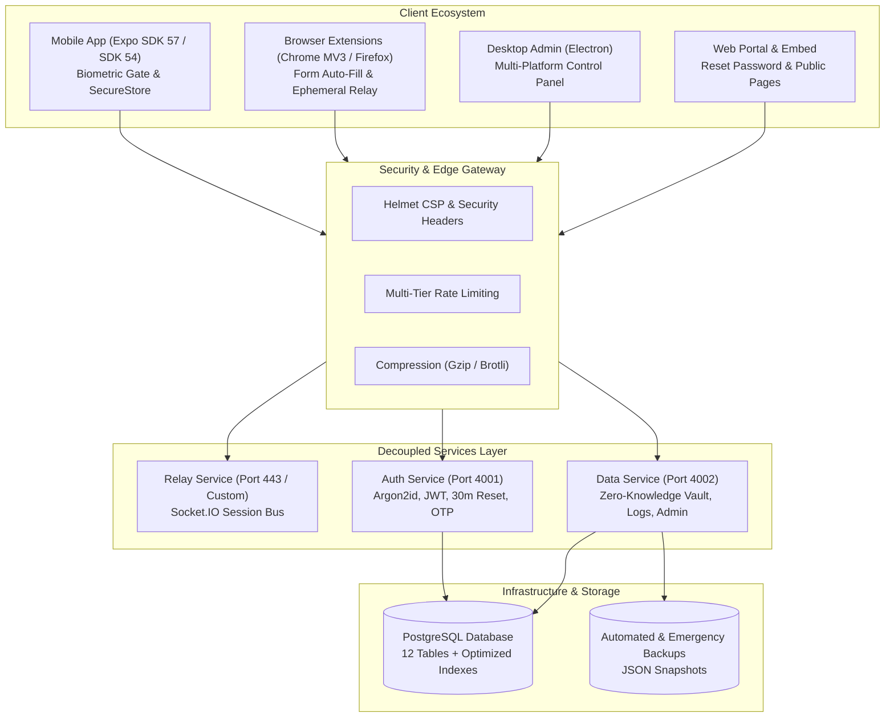

 FlakeSecure

[](package.json)
[](#-platform-support)
[](#-security-architecture--protocols)
[](ARCHITECTURE.md)
[](#)

> **Zero-Knowledge Biometric Cross-Platform Password, Bank Card, Code & 2FA Manager**  
> Scan QR code on your desktop browser or use native Android System Autofill on your phone → Confirm via Face ID / Touch ID / Fingerprint → Auto-fill logins, 2FA TOTP codes, and payment cards seamlessly via end-to-end encryption.

---

 Table of Contents

- [ What's New (Changelog)](#-whats-new-changelog)
- [ Architecture Blueprint](#-architecture-blueprint)
- [ Core Features](#-core-features)
- [ Embeddable Iframe & Drop-In SDK (For Website Providers)](#-embeddable-iframe--drop-in-sdk-for-website-providers)
- [ Project Structure](#-project-structure)
- [ Setup & Installation](#-setup--installation)
  - [1. Relay, Auth & Data Server](#1-relay-auth--data-server)
  - [2. Database Migrations](#2-database-migrations)
  - [3. Chrome / Edge / Chromium Extension](#3-chrome--edge--chromium-extension)
  - [4. Firefox Extension](#4-firefox-extension)
  - [5. Mobile App (iOS / Android)](#5-mobile-app-ios--android)
  - [6. Desktop Admin App (Windows & Linux)](#6-desktop-admin-app-windows--linux)
- [ Security Architecture & Protocols](#-security-architecture--protocols)
- [ Monitoring, Telemetry & Disaster Recovery](#-monitoring-telemetry--disaster-recovery)
- [ Scalability & Multi-Region Clustering](#-scalability--multi-region-clustering)
- [ Dependencies & Tech Stack](#-dependencies--tech-stack)
- [ License](#-license)

---

 What's New in Version 2.1.0 (System Autofill, Bank Cards, Codes, Offline Mode, Push Suite & Toast UI)

The **v2.1.0** release expands FlakeSecure into a full-featured biometric vault and native mobile autofill provider while introducing full offline resilience, GDPR-compliant regional push notifications, and a unified severity-coded Toast & Confirmation UI across all platforms:

 Highlights & New Features in v2.1.0:

1.  **Native Android System Autofill Service (`FlakeSecureAutofillService`)**:
    - Custom Expo Config Plugin (`plugins/withFlakeSecureAutofill.js`) generating a native Kotlin Android `AutofillService`, `FlakeSecureAutofillAuthActivity`, and React Native bridge (`FlakeSecureAutofillModule` / `autofillBridge.js`).
    - Auto-fills **Logins** (matching both web domains in Chrome/browsers and Android package names), **linked 2FA TOTP codes** (auto-computed in Kotlin via RFC 6238 and copied/filled), and **Bank Cards** in checkout forms.
    - Biometric gate (`BiometricPrompt`) with multi-account selection dialog displaying custom account labels and masked card numbers (`•••• 4821`).
    - Supports `onSaveRequest` (*"Save to FlakeSecure?"*) when submitting new credentials in third-party apps or browsers, importing them automatically into the hardware-backed vault.
    - Dedicated Autofill status card & 1-tap system settings shortcut in `SettingsScreen.js` (iOS `ASCredentialProviderViewController` specification documented in `additions.md`).
2.  **Encrypted Bank Accounts (`Bankkonten`) & Bank Cards Vault (`card`)**:
    - Group debit and credit cards under **Bank Accounts (`Bankkonten`)** (`flakesecure_bank_acc_<id>`) with **Account Name (`Kontoname`)** and **IBAN** (analogous to how logins are grouped under domains).
    - **Automatic BIC & Bank Detection (`ibanLookup.js`)**: Live ISO 13616 / Mod 97-10 IBAN checksum validation, 4-block IBAN formatting (`DE89 3704 0044 ...`), and instant offline BLZ/IID directory lookup that automatically populates the **Bank Name** and **BIC / SWIFT** (with non-blocking online fallback for regional Sparkassen/Volksbanken).
    - Store debit/credit cards in isolated hardware-backed SecureStore keys (`flakesecure_card_<id>`) with automatic brand detection (`Visa`, `Mastercard`, `Amex`, `Maestro`, `Girocard`, `Discover`, `JCB`), Luhn validation, cardholder name, expiry (`MM/YY`), optional `CVV`, optional `PIN` (with security advisory), bank name, `IBAN`, `BIC`, color theme (`Gold`, `Midnight`, `Emerald`, `Crimson`, `Ocean`, `Slate`), and encrypted notes.
    - Stylized credit card tile UI grouped under each Bank Account with masked IBAN/card numbers, 1-tap biometric reveal & copy for `IBAN`, `BIC`, `Card Number`, `Expiry`, `CVV`, and `PIN`, 30-day expiry warning badges, and 45-second clipboard auto-clear.
3.  **Encrypted Codes Vault (`code` — Door, Bike Lock, Safe, Alarm, Locker, Garage, Wi-Fi)**:
    - Dedicated vault tab and item type (`flakesecure_code_<id>`) for physical and digital access codes with custom SVG category icons, optional location field, and notes.
    - High-contrast large digit/character blocks after biometric unlock for easy reading at a door keypad or bike lock, plus QR sharing support (`ShareImportScreen.js` & `ScanScreen.js`).
4.  **Full Offline Vault Mode & Live Connectivity Detection**:
    - Fixed startup & biometric unlock flow in `AuthContext.js` so network timeouts or server unreachability never invalidate local `auth_token` or `auth_credentials`.
    - Unlock your local vault (Logins, Bank Cards, Codes, and 2FA TOTP codes) offline via biometrics (`BiometricUnlockScreen.js` and the *"Offline-Modus: Lokalen Tresor mit Biometrie öffnen"* action on `LoginScreen.js`).
    - Create and edit vault items offline with an automatic background sync queue (`flakesecure_pending_vault_sync_v1`) that flushes and notifies via toast as soon as connectivity returns; account deletion is safely blocked while offline.
    - Rich inline + toast login error presentation (`401` invalid credentials with field highlight, `429` rate-limit countdown, offline fallback, maintenance, and password policy checklist).
5.  **Severity-Coded Top Toast System with Countdown Timer & Custom Confirmation Sheet**:
    - Replaced all 109 native `Alert.alert` popups across all 12 mobile screens, the Web Portal (`account.html`, `reset-password.html`, `restore-account.html`), and Browser Extensions (`Chrome` & `Firefox`) with a top-of-screen Toast banner featuring:
      - Color-coded severities: **Error (Red `#ef4444`, 6s)**, **Warning (Amber `#f59e0b`, 4.5s)**, **Success (Green `#10b981`, 3.2s)**, and **Info (Blue `#3b82f6`, 3.5s)**.
      - Animated bottom countdown progress bar (pauses on press-and-hold / hover, dismisses on tap or swipe-up) and haptic feedback (`expo-haptics`).
    - Replaced native confirmation dialogs with a styled FlakeSecure Confirmation Modal / Bottom-Sheet (`toast.confirm` / `showFsConfirmModal`).
6.  **Push & Local Security Notification Suite + Regional IP Targeting + Desktop-Admin Deep-Links**:
    - **Server Push Events**: New login alerts (`A`), security alerts on password reset, session revocation & account deletion scheduling (`B`), credential/code sharing alerts (`C`), maintenance & system announcements (`G`), and custom admin notifications (`POST /api/notifications/admin/send`).
    - **Local On-Device Security Checks (`notifications.js`)**: 30-day card expiry warnings (`D`), periodic k-Anonymity HIBP breach checks for saved passwords (`E`), weekly weak/reused password reports (`F`), and 14-day vault backup/sync reminders (`H`).
    - **Granular Preferences**: Individual toggles for all server-push and local notification categories in `SettingsScreen.js` (`notification_prefs` table + local prefs).
    - **Desktop-Admin Custom Notifications & Regional Targeting**: Choose delivery mode (`In-App`, `Push`, or `Both`), deep-link target screen (`Home`, `Home:cards`, `Home:codes`, `Authenticator`, `Scan`, `Settings`, `Logs`, `ShareImport`, `VaultTransfer`), and GDPR-compliant regional targeting (`ALL`, `DE,AT,CH`, `DE`, `FR`, `ES`, `US,GB`, or custom ISO codes) evaluated locally via `geoip-lite` without storing raw IP addresses on push tokens.
7.  **Strict PM2 Process Log Isolation (`/admin`)**:
    - Fixed `GET /api/admin/pm2-logs` in `server/routes/admin.js` to read `flakesecure`'s own PM2 log path (`pm_out_log_path` / `pm_err_log_path` or `flakesecure-out*.log` / `flakesecure-error*.log`) instead of picking logs from unrelated PM2 services, displaying the verified process name in `admin.html`.

---

 What's New in Version 2.0.3 (Admin Telemetry, Anti-Enumeration, Password Hardening, 2FA Suite & Cross-Platform Parity)

The **v2.0.3** update introduces the integrated real-time Admin Monitoring Console, anti-enumeration registration & account restoration flows, enterprise password policy with server-proxied Have I Been Pwned (HIBP) checks, hardware-encrypted notes, server-proxied favicon caching, a comprehensive 2FA/TOTP suite (including Google Authenticator migration), automatic browser extension silencing on native Embed sites, and synchronized cross-platform release artifacts:

 Highlights & New Features in v2.0.3:

1.  **Admin Telemetry & Monitoring Dashboard (`/admin`)**:
    - Real-time Node.js heap and RSS memory meters, system uptime counters, active user & vault totals, live JWT sessions, and PostgreSQL pool telemetry.
    - Automated and on-demand encrypted database disaster recovery backup creation and download manager.
    - Full adaptive dark/light appearance system with dedicated toggle controls and resilient input contrast styling.
2.  **Shared Header & Footer Integration**:
    - Embedded unified navigation bar and GDPR-compliant legal footers across all administrative and portal endpoints.
3.  **Automatic Browser Extension Silencing on Native Embed Sites**:
    - When a website integrates the built-in FlakeSecure Embed SDK (`embed.js`), it sets `data-flakesecure-embed` on `<html>`, injects `<meta name="flakesecure-embed">`, and dispatches `flakesecure:embed-ready`.
    - Both the Chrome and Firefox extensions (`content.js`) automatically detect the native embed, stay completely silent (no floating button, overlay, focus listener, or duplicate WebSocket session), clean up if the embed loads dynamically, and display a localized status notice in the extension popup (`DE`, `EN`, `FR`, `ES`).
    - Includes a cross-platform packaging script (`browser-extension/pack-extensions.ps1`) that builds POSIX-compliant `.zip` archives with explicit directory entries and verified icon resolution.
4.  **Privacy-Preserving Anti-Enumeration & 30-Minute Account Restore Flow**:
    - **Zero Email Enumeration on Registration (`POST /api/otp/send`)**: Requesting a registration OTP for an already registered email returns an identical `200 OK` response with equalized Argon2 timing and rate limiting instead of exposing account existence to the client. Instead, the account owner receives a private notification email containing their `$username` and quick links to sign in or reset their password.
    - **One-Time Account Restoration (`/restore-account`)**: If an account is within its 30-day soft-delete window (`deletion_scheduled_at`), attempting to register with that email or signing in with the valid password dispatches a 30-minute single-use restoration link (`account_restore_tokens` table, SHA-256 hashed) to cancel scheduled deletion in one click, with a fallback support contact (`SUPPORT_EMAIL`).
    - **Hardened User Search (`GET /api/account/search`)**: Enforces a minimum query length of 3 characters, dedicated `searchLimiter` rate limiting (30 req / 15 min), and exact-match prioritization.
5.  **Enterprise Account Password Policy & Server-Proxied HIBP Breach Check**:
    - **Strict Password Rules (`server/utils/passwordPolicy.js`)**: Minimum 12 characters, no whitespace, at least 3 of 4 character classes (uppercase, lowercase, digit, special) unless using a 16+ character passphrase, blocks username/email local-part substrings ($\ge 3$ chars), blocks 4+ repeated or sequential/keyboard characters, and blocks common passwords (`server/utils/commonPasswords.txt`).
    - **Privacy-Preserving Have I Been Pwned (HIBP) Protection**: Server-side k-Anonymity range proxy (`GET /api/security/pwned-range/:prefix`) with `Add-Padding: true` and 1-hour in-memory caching ensures client IPs are never exposed to third parties while blocking compromised passwords at registration and password reset.
    - **Interactive Strength & Rule Checklist**: Live 4-level strength meter and real-time checklist across Web (`account.html`, `reset-password.html`) and Mobile (`LoginScreen.js`, `OnboardingScreen.js`).
6.  **Hardware-Encrypted Credential & 2FA Notes**:
    - **Biometric-Gated Notes**: Attach multiline notes (up to 1,000 characters for logins, 500 characters for 2FA entries) stored in isolated hardware-backed SecureStore keys (`flakesecure_note_<credId>`) to stay well within iOS Keychain item size limits.
    - **Selective QR Sharing & Vault Sync**: Notes are displayed only after biometric unlock in `ViewCredentialScreen.js`, indicated by a subtle note badge on `HomeScreen.js`, synchronized with the Zero-Knowledge Cloud Vault, and optionally toggleable (`Include notes`) when sharing credentials via QR code.
7.  **Privacy-Preserving Server Favicon Proxy & Mobile Disk Cache**:
    - **Server Favicon Proxy (`GET /api/favicon/:domain`)**: Fetches domain icons server-side (Google S2 $\rightarrow$ root domain $\rightarrow$ icon.horse $\rightarrow$ direct `/favicon.ico`) with strict SSRF protection, 30-day disk caching (`server/cache/favicons/`), and 7-day miss caching so client devices never leak visited domains to external icon providers.
    - **Client Disk Caching**: `FaviconImage.js` uses `expo-image` with disk caching, a 7-day `AsyncStorage` miss cache, and a 1-tap **"Clear Icon Cache"** action in `SettingsScreen.js`.
8.  **Comprehensive 2FA / TOTP Suite & Google Authenticator Migration**:
    - **8 Ways to Add 2FA**: Direct QR camera scan in `AuthenticatorScreen.js`, QR scan from gallery/screenshots (`expo-image-picker` + `Camera.scanFromURLAsync`), automatic routing from the main `ScanScreen.js`, clipboard `otpauth://` auto-detection & paste, system-wide `otpauth://` and `otpauth-migration://` deep links, and **Google Authenticator Bulk Export Import** (`otpauth-migration://offline?data=...` protobuf decoder in `otpMigration.js` with multi-QR batch support).
    - **Advanced RFC 6238 Support**: Full pure-JS support for `SHA1`, `SHA256`, and `SHA512` HMAC algorithms, `6` or `8` digits, and `30s` or `60s` periods (`totp.js`).
    - **Per-Account 2FA Linking (`credId`)**: Link TOTP generators directly to a specific domain account (or keep standalone 2FA entries), view live codes inside `ViewCredentialScreen.js`, and prioritize the linked account's TOTP when confirming logins on `ConfirmScreen.js`.
9.  **Multi-Account Domain Grouping & Custom Account Labels**:
    - Store multiple logins per domain grouped cleanly on `HomeScreen.js`, assign custom display labels (`name`) to distinguish accounts (while keeping shared-login usernames hidden), and choose the desired account in `ConfirmScreen.js` after scanning a login QR code.
10. **Cross-Platform Client Parity (v2.0.3)**:
    - 100% source parity across React Native (`FlakeSecure (SDK54)` & `FlakeSecure (SDK58)`), Chrome Extension, Firefox Extension, Web Portal, and Desktop Admin in German (`DE`), English (`EN`), French (`FR`), and Spanish (`ES`).

---

 What's New in Version 2.0.2 (Enterprise, Legal & Security Overhaul)

The **v2.0.2** update introduced an enterprise-grade architectural restructuring, complete GDPR/TDDDG compliance, active session hardware detection, multilingual legal portals, SEO optimization, and production telemetry:

 Highlights & New Features in v2.0.2:

1.  **Full Legal & Regulatory Compliance (GDPR / DSGVO, TDDDG, DDG & BGB)**:
   - **Impressum / Legal Notice (`/imprint`)**: Fully compliant with § 5 DDG & § 18 MStV, complete with dispute resolution disclosures.
   - **Privacy Policy (`/legal`)**: Comprehensive GDPR (DSGVO), BDSG & TDDDG compliant declaration explaining the Zero-Knowledge cryptographic model, tracking-free infrastructure, cookie-free operations, and user rights (Art. 15–21 GDPR).
   - **Terms of Service (`/terms`)**: BGB-compliant terms detailing the Zero-Knowledge security guarantee and liability limitations.
   - **Multi-Language Internationalization**: Dynamic real-time switching between **German (DE)**, **English (EN)**, **French (FR)**, and **Spanish (ES)** across all legal pages without page reloads.

2.  **Official GDPR Record of Processing Activities (VVT) & DSFA (`docs/legal/`)**:
   - **`docs/legal/VVT_FlakeSecure.md`**: Pre-compiled official Record of Processing Activities (Art. 30 GDPR) covering all 6 processing operations, legal bases (Art. 6 (1) (b) & (f)), and deletion concepts.
   - **`docs/legal/DSFA_FlakeSecure.md`**: Data Protection Impact Assessment & Technical and Organizational Measures (TOMs) according to Art. 35 & Art. 32 GDPR with risk matrix and Zero-Knowledge security verification.

3.  **Active Session Management & Technical Device Model Detection**:
   - Extraction and display of exact hardware models (e.g. `Apple iPhone (iOS 17.4)`, `Samsung Galaxy S23`, `Windows PC Chrome`) across both mobile apps and web account portal.
   - Distinct **`[Active] Dieses Gerät` / `[Active] This Device`** badge highlighting the current active session.
   - 1-Tap remote session revocation to instantly invalidate stolen or unfamiliar devices.

4.  **45-Second Clipboard Auto-Clear**:
   - Automatically wipes sensitive master passwords, generated secrets, and TOTP 2FA tokens from the mobile system clipboard after 45 seconds to prevent background app snooping.

5.  **Zero-Knowledge URL Fragment Deep-Linking**:
   - Ephemeral session encryption keys are transferred strictly in URL hash fragments (`#key=...`), ensuring keys never touch HTTP request headers, server logs, or reverse proxy caches.

6.  **Zero-Knowledge Privacy Safeguards & Audit Log Sanitization**:
   - Target domain names and sensitive URLs are strictly stripped from server login audit logs.
   - Automatic 90-day retention purge for access logs.
   - **30-Day Soft-Delete Safeguard Window**: Accidental user deletions enter a 30-day deactivation phase with automated permanent purge upon expiration.

7.  **Search Engine Optimization (SEO) & Web Crawling Assets**:
   - **`robots.txt`**: Standard robot exclusion allowing indexation of public/legal routes while blocking private API endpoints.
   - **`sitemap.xml`**: XML Sitemap 0.9 with `xhtml:link` multilingual alternates for all 4 languages.
   - **Social Sharing & Meta Tags**: Open Graph (`og:*`), Twitter Card (`twitter:*`), and favicon/touch icons across all web pages.

8.  **Skeleton Loading Everywhere (Zero Spinners)**:
   - Built custom pulse skeleton components (`CredentialCardSkeleton`, `LogRowSkeleton`, `SessionCardSkeleton`, `DetailFieldSkeleton`, `SkeletonItem`) with smooth looping opacity pulses.
   - Eliminates layout shifting across `HomeScreen`, `LogsScreen`, `SettingsScreen`, `ViewCredentialScreen`, and `ConfirmScreen`.

9.  **Native Spring Tap Feedback (`TapFeedback.js`)**:
   - Native-driver spring-scale pressable animation (`scale: 0.96`, tension: 100, friction: 8) wrapping action buttons, quick bars, filters, and credential cards for responsive physical haptic feel.

10.  **Decoupled 3-Service Microservice Topology**:
    - Refactored server into three independent microservices runnable standalone or unified:
      - **Relay Service** (`services/relay/relayService.js`, `bin/relay.js`): Socket.IO WebSockets & ephemeral session bus.
      - **Auth Service** (`services/auth/authService.js`, `bin/auth.js`): Argon2id password hashing, JWTs, OTPs, and 30-min password resets.
      - **Data Service** (`services/data/dataService.js`, `bin/data.js`): Zero-Knowledge vault sync, audit logs, and admin telemetry.

11.  **30-Minute Password Reset Flow with Zero-Knowledge Conflict Handling**:
    - Cryptographically random 32-byte tokens stored as SHA-256 hashes in `password_resets` table.
    - 30-minute expiry window, single-use validation, and global session revocation upon reset.
    - Branded multi-lingual emails (`en`, `de`, `fr`, `es`) with explicit Zero-Knowledge vault conflict notices.

12.  **Enterprise Security & Perimeter Hardening**:
    - **Helmet Security Headers**: Content-Security-Policy (CSP), HSTS, X-Frame-Options (`SAMEORIGIN`), X-Content-Type-Options (`noSniff`).
    - **Multi-Tier Rate Limiting** (`middleware/rateLimit.js`): Global (300/15m), Auth (15/15m), OTP (5/10m), Relay (60/15m), Admin Login (5/15m).
    - **HTTP Compression**: Gzip and Brotli compression via `compression` middleware.
    - **Branded Custom Error Pages**: Custom HTML pages for `404.html`, `500.html`, `403.html`, `429.html` + structured JSON errors for APIs.
    - **Strict Tenant Segregation**: Enforced `WHERE user_id = $1` on all private vault, session, and log queries.

13.  **Admin Monitoring, Telemetry & 1-Click Backups (`/admin`)**:
    - Modern administrative dashboard (`server/static/admin.html`) authenticated with `.env` credentials (`ADMIN_EMAIL`, `ADMIN_PASSWORD`).
    - Live telemetry: Memory (RSS/Heap), CPU utilization, Uptime, and PostgreSQL connection stats.
    - Complete 1-click JSON database backup generation and authenticated download.

14.  **Automated Disaster Recovery & Crash Snapshots**:
    - Automatic emergency JSON database dump (`server/backups/emergency-snapshot-<timestamp>.json`) triggered on `uncaughtException` or `unhandledRejection`.
    - Automated critical alert emails dispatched to `ADMIN_EMAIL`.

15.  **Enterprise Email Security (SPF, DKIM, DMARC) & Cloudflare DNS Support**:
    - Full DNS-only grey-cloud configuration guide for Cloudflare + IONOS SMTP integration to guarantee OTP email deliverability.

---

 Architecture Blueprint

For an exhaustive architectural deep-dive, see [**ARCHITECTURE.md**](ARCHITECTURE.md).



---

 Core Features

- ** Native Android System Autofill (`FlakeSecureAutofillService`)**: Fill logins, linked 2FA TOTP codes, and bank cards directly inside Android apps and browsers (Chrome, etc.) via biometric authentication, with automatic *"Save to FlakeSecure?"* capture on new logins.
- ** Instant QR Login & Multi-Account Selection**: Scan a QR code to sign in without typing passwords; group multiple accounts per domain with custom display labels and choose which account to use upon scanning.
- ** Encrypted Bank Cards & Access Codes**: Dedicated biometric-gated vault tabs for **Bank Cards** (Luhn check, brand detection, expiry alerts, CVV/PIN with 45s auto-clear) and **Codes** (Door, Bike Lock, Safe, Alarm, Locker, Garage, Wi-Fi — with large keypad-friendly digit display and QR sharing).
- ** Full Offline Vault Mode & Live Connectivity Detection**: Access and edit passwords, cards, codes, and 2FA codes offline via biometric unlock; automatic sync queue flushes changes upon reconnection.
- ** Severity-Coded Top Toasts & Styled Confirmation Modals**: Color-coded top banners (Red/Amber/Green/Blue) with animated countdown progress bars, press-to-pause, and haptics across Mobile, Web Portal, and Browser Extensions.
- ** Push & Local Security Notification Suite**: Server pushes (new logins, security events, received shares, maintenance, and custom Desktop-Admin deep-link notifications with GDPR-compliant `geoip-lite` regional targeting) plus local on-device checks (expiring cards, HIBP password breaches, weak/reused passwords, backup reminders).
- ** Embeddable Provider SDK & Auto-Silenced Extension**: Website owners can embed biometric QR login directly into their pages; the FlakeSecure browser extension automatically detects the native embed and pauses itself completely.
- ** Advanced 2FA / TOTP Suite**: Supports `SHA1`/`SHA256`/`SHA512`, `6`/`8` digits, `30s`/`60s` periods, per-credential linking (`credId`), QR camera scan, screenshot/gallery import, clipboard detection, and **Google Authenticator bulk migration (`otpauth-migration://`)**.
- ** Encrypted Credential & 2FA Notes**: Hardware-backed encrypted multiline notes (`flakesecure_note_<credId>`) protected behind biometric authentication, with optional inclusion when sharing credentials via QR.
- ** Enterprise Password Policy & HIBP Protection**: Enforces 12+ character complexity (or 16+ char passphrases), sequence/personal-info filtering, common-password blocking, and server-proxied **Have I Been Pwned** k-Anonymity breach checks.
- ** Privacy-First Anti-Enumeration & Account Restore**: Prevents email enumeration on registration and login, sending private account-existence notices or 30-minute single-use account restoration links (`/restore-account`) via email.
- ** Privacy-Preserving Favicon Proxy & Disk Cache**: Server-proxied domain icon resolution (`/api/favicon/:domain`) with SSRF protection and 30-day disk caching paired with `expo-image` client caching.
- ** End-to-End Encryption & Zero-Knowledge Cloud Vault**: AES-256-CTR + HMAC-SHA256 with ephemeral session keys and client-side PBKDF2 encrypted cloud synchronization.

---

 Embeddable Iframe & Drop-In SDK (For Website Providers)

FlakeSecure allows website operators and service providers to integrate zero-knowledge biometric login directly on their login pages.

 How It Works (Zero-Knowledge Architecture):
1. The provider embeds the FlakeSecure widget via `iframe` or the `embed.js` script.
2. The iframe generates a 32-byte AES key (`keyHex`) and 16-byte session ID (`sid`) **locally in browser memory** via Web Crypto API. The key is **never sent to the FlakeSecure server**.
3. A dynamic QR code is displayed on the screen.
4. The user scans the QR code with their **FlakeSecure Mobile App** and approves via biometrics (Face ID / Fingerprint).
5. The mobile app encrypts the credentials for that domain with `keyHex` using AES-256-CTR + HMAC-SHA256 and sends the ciphertext to the relay.
6. The FlakeSecure relay server forwards the ciphertext to the iframe via Socket.IO. **The FlakeSecure server never sees unencrypted data.**
7. The iframe decrypts the payload locally using `keyHex` in browser memory.
8. The decrypted credentials are sent to the host page via `postMessage`, where the SDK automatically fills the username and password fields and triggers normal form submission.
9. **The provider's backend receives credentials through their standard login endpoint (POST request), exactly as if the user typed them manually!**

 Quick Integration:
```html
<!-- One-Line Script Tag -->
<script src="https://flakesecure.snowystudio.dev/embed.js" 
        data-auto-mount="true" 
        data-theme="dark" 
        data-auto-submit="true">
</script>
```

**Live Interactive Demo & Sandbox**: Visit `https://flakesecure.snowystudio.dev/embed/demo` to test the widget live, simulate mobile scans, and customize code snippets.

---

 Project Structure

```
flakesecure/
├── ARCHITECTURE.md                  # Comprehensive System Blueprint & Security Specification
├── README.md                        # Project documentation & overview
├── SCALABILITY.md                   # Multi-region clustering & Redis adapter documentation
│
├── server/                          # Decoupled Node.js Enterprise Server
│   ├── server.js                    # Unified master server (HTTPS / HTTP orchestration)
│   ├── db.js                        # PostgreSQL connection pool with SSL & health checks
│   ├── migrate.js                   # Automated database migration & index verification
│   ├── package.json                 # Server dependencies (helmet, compression, rate-limit, etc.)
│   ├── db/
│   │   └── schema.sql               # 13-table PostgreSQL schema with performance B-tree indexes
│   ├── services/                    # Decoupled Microservices
│   │   ├── relay/relayService.js    # Ephemeral Socket.IO session bus & message forwarding
│   │   ├── auth/authService.js      # Argon2id auth, 30m password resets & account restore, email OTPs
│   │   └── data/dataService.js      # Zero-Knowledge vault, audit logs, admin telemetry, favicon proxy
│   ├── bin/                         # Independent Service Runners
│   │   ├── relay.js                 # Standalone Relay Service runner (Port 443)
│   │   ├── auth.js                  # Standalone Auth Service runner (Port 4001)
│   │   └── data.js                  # Standalone Data Service runner (Port 4002)
│   ├── middleware/
│   │   ├── auth.js                  # JWT & SHA-256 session token verification
│   │   └── rateLimit.js             # Multi-tier rate limiting (global, auth, otp, relay, admin, search, pwned, favicon)
│   ├── routes/
│   │   ├── auth.js                  # Register, login, forgot/reset-password, restore-account, password-policy, /me
│   │   ├── account.js               # User profile, active sessions, whitelist, anti-enumeration search
│   │   ├── security.js              # Server-proxied HIBP k-Anonymity range endpoint (/pwned-range/:prefix)
│   │   ├── favicon.js               # SSRF-safe domain favicon resolver & 30-day disk cache (/favicon/:domain)
│   │   ├── vault.js                 # Zero-Knowledge cloud vault sync & conflict detection
│   │   ├── admin.js                 # Telemetry metrics, audit logs, 1-click JSON backups
│   │   ├── logs.js                  # Paginated security audit logs (limit capped at 100)
│   │   ├── otp.js                   # Anti-enumeration email OTP generation & verification
│   │   ├── system.js                # System health, announcements, maintenance modes
│   │   ├── share.js                 # P2P encrypted payload exchange
│   │   ├── embed.js                 # Provider embed widget endpoints
│   │   └── notifications.js         # Expo push notification dispatcher
│   ├── utils/
│   │   ├── email.js                 # Branded HTML email templates (OTP, exists notice, restore, resets, alerts)
│   │   ├── passwordPolicy.js        # Password complexity validator & HIBP k-Anonymity checker
│   │   └── commonPasswords.txt      # Common compromised passwords blocklist
│   ├── static/                      # Static web portal & custom error pages
│   │   ├── admin.html               # Real-time admin telemetry dashboard
│   │   ├── reset-password.html      # 30-minute password reset interface with live password checklist
│   │   ├── restore-account.html     # 30-minute single-use account restoration interface
│   │   ├── 404.html                 # Custom 404 Not Found error page
│   │   ├── 500.html                 # Custom 500 Server Error error page
│   │   ├── 403.html                 # Custom 403 Forbidden error page
│   │   ├── 429.html                 # Custom 429 Rate Limit Exceeded error page
│   │   └── account.html             # Web user account portal with live strength meter & HIBP check
│   └── public/                      # Public assets, stylesheets & embed SDK
│       ├── embed.js                 # Universal drop-in JavaScript SDK (sets data-flakesecure-embed)
│       └── embed/
│           ├── widget.html          # Responsive iframe widget
│           └── demo.html            # Interactive developer sandbox
│
├── FlakeSecure (SDK58)/             # React Native Mobile App (Expo SDK 58 - Primary)
│   ├── App.js                       # Root Navigator, ToastProvider, push/deep-link handler & unlock gate
│   ├── app.json / eas.json          # Build configuration, URL schemes & Android Autofill Config Plugin
│   ├── plugins/
│   │   └── withFlakeSecureAutofill.js # Expo Config Plugin generating Kotlin FlakeSecureAutofillService
│   └── app/src/
│       ├── components/
│       │   ├── Toast.js             # Severity-coded top Toast with timer bar & Confirmation Bottom-Sheet
│       │   ├── Skeleton.js          # Pulse skeleton placeholders (cards, rows, fields)
│       │   ├── TapFeedback.js       # Spring scale-down tap animation wrapper
│       │   ├── FaviconImage.js      # Server-proxied domain favicon component with expo-image disk cache
│       │   └── PasswordChecklist.js # Live password rule checklist, 4-level strength bar & HIBP warning
│       ├── context/
│       │   ├── AuthContext.js       # Offline-resilient authentication state, auto-sync, biometric unlock
│       │   └── LanguageContext.js   # Dynamic i18n multi-language provider (DE, EN, FR, ES)
│       ├── screens/
│       │   ├── HomeScreen.js        # Segmented vault (Logins | Bank Cards | Codes), custom labels & skeletons
│       │   ├── ScanScreen.js        # Universal QR scanner (Login, Share, Code, Reg, Transfer, otpauth)
│       │   ├── ConfirmScreen.js     # Multi-account selector, biometric confirmation & linked 2FA streaming
│       │   ├── AuthenticatorScreen.js # RFC 6238 TOTP suite (QR, gallery, clipboard, Google Auth migration, credId link)
│       │   ├── CredentialsScreen.js # Add/edit Logins, Bank Cards & Codes with notes & 2FA prompt
│       │   ├── ViewCredentialScreen.js # Biometric-gated detail view for Logins, Cards & Codes
│       │   ├── SettingsScreen.js    # Active sessions, Autofill setup, notification prefs, vault sync & profile
│       │   ├── LogsScreen.js        # Audit logs with row skeletons & filters
│       │   ├── VaultTransferScreen.js # Cross-device P2P vault migration
│       │   ├── RegisterFillScreen.js # Registration autofill & password generator
│       │   ├── ShareImportScreen.js # Secure QR sharing for Logins & Codes with selectable notes & expiry
│       │   ├── LoginScreen.js       # Server login, inline/toast error states & offline biometric vault unlock
│       │   ├── BiometricUnlockScreen.js # Online & offline biometric app unlock
│       │   ├── OnboardingScreen.js  # First-time onboarding wizard with live password policy
│       │   └── MaintenanceScreen.js # Blocking maintenance & offline screen
│       └── utils/
│           ├── api.js               # REST client with dynamic getServerUrl() & live connectivity tracking
│           ├── autofillBridge.js    # JS bridge to native Android FlakeSecureAutofillService
│           ├── notifications.js     # Expo push registration, deep-link routing & local security checks
│           ├── crypto.js            # AES-256-CTR & HMAC-SHA256 with 4-byte UTF-8
│           ├── vault.js             # PBKDF2 vault key derivation & cloud sync
│           ├── storage.js           # Hardware-backed SecureStore for Logins, Cards, Codes & isolated notes
│           ├── passwordPolicy.js    # Client password complexity & server-proxied HIBP validator
│           ├── totp.js              # Pure JS TOTP generator (SHA1/SHA256/SHA512, 6/8 digits, 30/60s)
│           └── otpMigration.js      # Google Authenticator protobuf decoder (otpauth-migration://)
│
├── FlakeSecure (SDK54)/             # React Native Mobile App (Expo SDK 54 - 100% Mirrored)
│
├── browser-extension/               # Chrome / Edge / Chromium Extension (Manifest V3)
│   ├── pack-extensions.ps1          # Cross-platform POSIX ZIP packager for Chrome & Firefox
│   └── extension/
│       ├── manifest.json
│       ├── content.js               # Form detection, autofill, login overlay & native embed auto-silence
│       ├── popup.html / popup.js    # Account login, status card, embed-paused notice & settings
│       └── styles/content.css
│
├── browser-extension-firefox/       # Firefox Add-on (Manifest V3)
│   └── extension/
│       ├── manifest.json
│       ├── background.js            # Background worker & WebSocket proxy
│       ├── content.js               # Form detection using browser.* API & native embed auto-silence
│       └── popup.html / popup.js
│
└── Desktop-Admin/                   # Cross-Platform Electron Dashboard (Win / Linux)
    ├── main.js                      # Electron main process & IPC handlers
    ├── preload.js                   # Secure context bridge
    ├── package.json                 # electron-builder config
    └── renderer/
        ├── index.html               # Glassmorphism control panel
        └── styles.css               # Color-matched customized scrollbars
```

---

 Setup & Installation

 1. Relay, Auth & Data Server

 Prerequisites:
- Node.js (v18+)
- PostgreSQL Database
- SMTP Server credentials (for OTPs, account existence notices, account restore & password reset emails)

 Installation:
```bash
cd server
npm install
```

 Configuration (`server/.env`):
Create a `.env` file in the `server/` directory:
```env
PORT=4000
BASE_URL=https://flakesecure.snowystudio.dev
PGHOST=localhost
PGPORT=5432
PGDATABASE=flakesecure
PGUSER=postgres
PGPASSWORD=your_postgres_password
JWT_SECRET=your_super_secret_jwt_key_at_least_64_characters

 Admin Portal & Support Credentials:
ADMIN_EMAIL=admin@snowystudio.dev
ADMIN_PASSWORD=your_secure_admin_password
SUPPORT_EMAIL=snowy@snowystudio.dev

 SMTP Configuration for OTP, Account Restore & Password Resets:
SMTP_HOST=smtp.your-provider.com
SMTP_PORT=587
SMTP_USER=noreply@flakesecure.snowystudio.dev
SMTP_PASS=your_smtp_password
SMTP_FROM=FlakeSecure <noreply@flakesecure.snowystudio.dev>
```

---

 2. Database Migrations

FlakeSecure includes an idempotent auto-migration runner (as well as automatic startup schema verification) that creates missing tables, columns, and indexes:
```bash
node server/migrate.js
```

 Run Server:
```bash
 Unified Server (Monolithic orchestration):
npm start
 → Server runs on port 4000 (Health check: http://localhost:4000/health)

 Or Run Decoupled Microservices:
node bin/relay.js   # Relay WebSocket Service (Port 443)
node bin/auth.js    # Auth & Identity Service (Port 4001)
node bin/data.js    # Vault & Data Service (Port 4002)
```

---

 3. Chrome / Edge / Chromium Extension

1. Open `chrome://extensions` in your browser.
2. Enable **Developer mode** in the top right.
3. Click **Load unpacked**.
4. Select `browser-extension/extension/`.

---

 4. Firefox Extension

1. Open Firefox and navigate to `about:debugging#/runtime/this-firefox`.
2. Click **Load Temporary Add-on...**.
3. Select `manifest.json` inside `browser-extension-firefox/extension/`.

**Repackaging Browser Extensions (Chrome & Firefox `.zip`)**:
```powershell
powershell -ExecutionPolicy Bypass -File browser-extension/pack-extensions.ps1
```
This rebuilds `server/public/FlakeSecure_chrome-v<version>.zip` and `server/public/FlakeSecure_firefox-v<version>.zip` with POSIX forward-slash paths and explicit directory entries (`icons/`, `lib/`, `styles/`).

---

 5. Mobile App (iOS / Android)

```bash
cd "FlakeSecure (SDK58)"
npm install

 Start development server:
npx expo start
```
- **Android**: Open Expo Go → scan QR code, or press `a` for Android Emulator.
- **iOS**: Open Camera → scan QR code, or press `i` for iOS Simulator.

> **Note on Native Modules**: Because `expo-image`, `expo-file-system`, and `expo-image-picker` as well as the custom `otpauth://` and `otpauth-migration://` URL schemes (`app.json`) touch native layers, create a new native build (`eas build` or `npx expo run:android` / `npx expo run:ios`) when deploying outside Expo Go.

```bash
 Production Builds (EAS):
eas build -p android --profile preview
eas build -p ios --profile preview
```

---

 6. Desktop Admin App (Windows & Linux)

```bash
cd Desktop-Admin
npm install
npm start

 Build executables:
npm run build:win     # Windows .exe in dist/
npm run build:linux   # Linux .AppImage & .deb in dist/
```

---

 Security Architecture & Protocols

FlakeSecure is built strictly upon the **Zero-Knowledge Principle**: The relay server transports only authenticated ciphertexts and never possesses cryptographic keys or plaintext passwords.

```
Browser Extension                Relay Server                   Mobile App
      │                               │                              │
      │  ① Generate session & AES key │                              │
      │     (sid, key, domain)        │                              │
      │                               │                              │
      │  ② Socket: join(sid, domain) ─►│                              │
      │                               │                              │
      │  ③ Display QR code:           │                              │
      │     flakesecure://auth?       │                              │
      │     sid=...&key=...&domain=.. │                              │
      │                               │        ④ Scan QR code        │
      │                               │◄─────────────────────────────│
      │                               │                              │
      │                               │        ⑤ Select account &    │
      │                               │          Verify biometrics   │
      │                               │          (Face ID / TouchID) │
      │                               │                              │
      │                               │        ⑥ AES-256 Encrypt     │
      │                               │          + HMAC-SHA256 Tag   │
      │                               │                              │
      │                               │  ⑦ POST /send-login          │
      │                               │     { sid, payload }         │
      │                               │◄─────────────────────────────│
      │                               │                              │
      │  ⑧ Socket: login-data ◄───────│  (Keep session open for 2m)  │
      │     (Encrypted payload)       │                              │
      │                               │                              │
      │  ⑨ Decrypt with local key     │                              │
      │     & autofill login form     │                              │
      │                               │                              │
      │                               │  ⑩ (Optional) Stream 2FA:    │
      │                               │     POST /send-totp          │
      │                               │◄─────────────────────────────│
      │                               │                              │
      │  ⑪ Socket: totp-data ◄────────│                              │
      │     & autofill OTP input      │  (Session purged from RAM)   │
      ▼                               ▼                              ▼
```

 Security Guarantees:
- ** Authenticated Encryption**: AES-256-CTR with HMAC-SHA256 (Encrypt-then-MAC) prevents eavesdropping and tampering.
- ** Ephemeral Keys**: 256-bit session keys transmitted exclusively over the physical optical QR channel.
- ** Zero-Knowledge Cloud Vault**: PBKDF2 (SHA-256) client-derived keys protect all server-stored vault backups.
- ** 30-Minute Reset & Restore Expiration**: Short-lived password reset and account restoration tokens stored as SHA-256 hashes with single-use enforcement.
- ** Anti-Enumeration & HIBP k-Anonymity**: Equalized response timing/status on registration & login and server-proxied 5-char SHA-1 prefix HIBP checks with `Add-Padding: true`.
- ** Multi-Tier Rate Limiting**: Dedicated rate limits for login attempts, OTP codes, account searches, HIBP checks, favicon lookups, relay endpoints, and admin portal.
- ** Hardware-Backed Storage**: Mobile credentials and isolated credential notes (`flakesecure_note_<credId>`) stored in the iOS Keychain / Android Keystore via `expo-secure-store`.
- ** HTTP Headers (Helmet)**: Strict CSP, HSTS, X-Frame-Options (`SAMEORIGIN`), and MIME sniffing protection.

---

 Monitoring, Telemetry & Disaster Recovery

FlakeSecure includes comprehensive production monitoring and disaster recovery capabilities:

1. **Admin Telemetry Dashboard (`/admin`)**:
   - Live CPU and Memory utilization (RSS, Heap Used, Heap Total).
   - System Uptime and PostgreSQL connection health.
   - Comprehensive audit logs and activity histories.
2. **1-Click Database Backups**:
   - Instant JSON database export (`POST /api/admin/backup`).
   - Authenticated secure download of backup archives (`GET /api/admin/backup/download/:filename`).
3. **Automated Disaster Recovery**:
   - Automatic emergency JSON database snapshot created in `server/backups/` upon uncaught exceptions.
   - Immediate high-priority email alert dispatched to `ADMIN_EMAIL`.

---

 Scalability & Multi-Region Clustering

For large-scale deployments, FlakeSecure supports horizontal scaling and geo-distributed clustering. See [SCALABILITY.md](SCALABILITY.md) for details on:
- **GeoDNS Regional Routing** (`de.flakesecure...`, `us.flakesecure...`, `ap.flakesecure...`).
- **Socket.IO Redis Pub/Sub Adapter** (`@socket.io/redis-adapter`) for cross-instance WebSocket broadcasting.
- **Nginx Sticky Session Load Balancing** and **PgBouncer Database Connection Pooling**.

---

 Dependencies & Tech Stack

| Component | Technologies & Packages |
|-----------|-------------------------|
| **Server** | `Node.js`, `Express`, `Socket.IO`, `PostgreSQL` (`pg`), `Argon2`, `JSONWebToken`, `Nodemailer`, `Helmet`, `Compression`, `express-rate-limit`, `Expo-Server-SDK`, `GeoIP-Lite`, `CORS`, `dotenv` |
| **Embed SDK & Iframe** | HTML5, CSS3, Web Crypto API (`crypto.subtle`), `Socket.IO Client`, `qrcode.js`, Cross-Origin `postMessage` |
| **Chrome Extension** | Manifest V3, Web Crypto API (`crypto.subtle`), `qrcode.js`, `socket.io-client`, Vanilla JS & CSS3 |
| **Firefox Extension** | Manifest V3 (Gecko WebExtension), `browser.*` API, Web Crypto API, `qrcode.js`, `socket.io-client` |
| **Mobile App** | `React Native`, `Expo SDK 57` & `Expo SDK 54`, `expo-camera`, `expo-image`, `expo-file-system`, `expo-image-picker`, `expo-notifications`, `expo-haptics`, `expo-local-authentication`, `expo-secure-store`, `expo-crypto`, `expo-clipboard`, `@react-navigation/native-stack`, `i18n-js`, `expo-linear-gradient`, `react-native-qrcode-svg`, Custom Kotlin Android `AutofillService` Config Plugin |
| **Desktop Admin** | `Electron`, Node.js, `electron-builder` (Windows `.exe`, Linux `.AppImage`/`.deb`) |

---

 License

This project is licensed under the **MIT License**. For legal notices, see `/legal` and `/imprint` in the web application.
